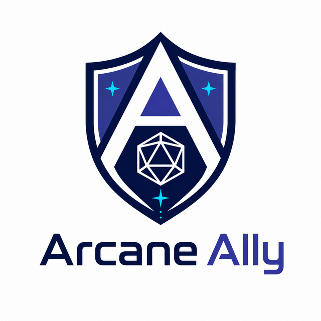

# Arcane Ally

<p align="center">
  
</p>

A self-hosted companion application for D&D 5e, with real-time party management, configured AI tools, and a DM command center.

## November 13 update

The update fixes nested character-card keyboard actions, restores the missing read-only DM Inspector, adds a local token spotlight for overlapping tokens, and protects condition removal and zero-HP recovery with regression tests. Dependency maintenance resolves the current client/server audit findings; scoped TypeScript lint and dependency checks run in CI.

Published through PR #8 and deployed on Bastet as `aaeb9848e72f3f23266531bd1884d7c7362f5ace`. See the [deployment receipt](docs/DEPLOYMENT_RECEIPT_2026-11-13.md), [verification](docs/PRODUCT_UPDATE_VERIFICATION_2026-11-13.md), [dependency maintenance](docs/DEPENDENCY_MAINTENANCE_2026-11-13.md), and [TypeScript lint scope](docs/CLIENT_LINT_SCOPE.md).

## October 22 product polish

Rules Sage now has named controls, keyboard dismissal, and focus restoration without losing messages or drafts. Codex search has an explicit accessible name and search semantics. Battlemap can display server-supplied broad health labels when exact HP is absent, with accessible token descriptions and contextual legend help.

These changes first shipped on Bastet as `417ae5e4ef2ebe42ed5ddc827e7405b9bf3532e7` and remain in the current release. That October update changed no server code, schema, dependency, or permission policy. Its [implementation verification](docs/PRODUCT_POLISH_VERIFICATION_2026-10-22.md) and [deployment receipt](docs/DEPLOYMENT_RECEIPT_2026-10-22.md) are historical; November maintenance above supersedes its dependency findings.

## October battlemap improvements

The October release rejects malformed realtime map snapshots before rendering, groups the three persistent table tools into one responsive dock, labels DM/player/cast access modes, and shows only role-projected AC and condition chips. Authenticated DMs can inspect UVTT/DD2VTT dimensions and geometry through a zero-write receipt before deciding whether to import anything.

See [implementation verification](docs/PRODUCT_PLAN_VERIFICATION_2026-10-05.md) and the [verified October deployment receipt](docs/DEPLOYMENT_RECEIPT_2026-10-05.md). Arcane Codex includes preview limits, role visibility, table-tools guidance, and snapshot recovery.

## September product improvements

Private prep notes support `@` links and scene-marker entry points. Without an active map, Battlemap shows a read-only encounter board; use a cast link for a shared audience. New-session guidance appears after confirmed DM bootstrap, and Archive explains access/loading failures without losing navigation.

See [implementation verification](docs/PRODUCT_PLAN_VERIFICATION_2026-09-17.md) for scope, checks, and release status. Run `npm run typecheck` in `client` for the explicit application checks. For an isolated host development backend, set `ARCANE_BACKEND_URL` before starting Vite; the default remains the container backend.

## Quick Start

```bash
git clone --branch automation/arcane-ally-live-baseline https://github.com/jbright471/Arcane-Ally.git
cd Arcane-Ally

cp .env.example .env
cp server/.env.example server/.env
```

# Terminal 1: backend
```bash
cd server
npm ci
npm start
```

# Terminal 2: frontend
```bash
cd client
npm ci
ARCANE_BACKEND_URL=http://localhost:3001 npm run dev
```

For PowerShell, set `$env:ARCANE_BACKEND_URL="http://localhost:3001"` before `npm run dev`. Container development keeps the default `http://dnd-party-sync-backend:3001` target.

- Frontend dev server: `http://localhost:5173`
- Backend API and Socket.io gateway: `http://localhost:3001`
- Default DM PIN comes from `.env` / `server/.env`; change it before exposing the app beyond your LAN.

## The Stack

- **Frontend:** React 19, TypeScript, Vite, Tailwind CSS v4, shadcn/ui, Radix UI
- **Backend:** Node.js (Express), Socket.io (real-time sync), Better-SQLite3
- **AI Layer:** Configured Ollama integration for PDF parsing, item stat extraction, homebrew generation, lore generation, and actionable entity creation
- **Deployment:** Multi-stage Dockerfile, with local dev via Vite + Express and optional external Portainer/Compose stack configuration

## Core Features

### Real-Time Synchronization
HP, condition, spell-slot, buff, and dice-roll updates reach authorized clients through the server's role-specific projections. The one-way state pipeline is:

```
Client action → Authorized server handler → DB mutation → Role-projected updates
```

Dice rolls can be public, private, secret, or super-secret. Secret modes are generated server-side and routed only to the DM, with optional masked acknowledgement for the rolling player.

### Character Management
- **D&D Beyond Import** — paste a character URL to pull stats, equipment, spells, and inventory from the DDB API
- **PDF Import** — upload a character sheet PDF; the AI parser extracts stats, classes, abilities, and spells
- **Re-Sync** — pull latest changes from D&D Beyond without creating duplicates
- **Manual Creation** — build a character from scratch with full stat entry
- **Keyboard card actions** — Enter or Space on a focused card opens its sheet or selects it. Nested Inspector, History, and options controls keep their own keyboard actions.

### Interactive Character Sheets
- **Clickable Ability Scores** — click any stat to roll d20 + modifier, broadcast to the DM's Roll Feed
- **Roll Visibility Controls** — players can roll publicly, privately to the DM, secretly with a masked acknowledgement, or super-secretly with no local result shown
- **Skill & Save Proficiency Dots** — per-skill and per-save proficiency imported from D&D Beyond; dots show none / half / proficient / expertise with amber highlight for expertise
- **Weapon Actions** — click to roll attack (d20 + proficiency + ability mod) and damage simultaneously; weapon stats imported from D&D Beyond
- **Spell Casting** — one-click casting with automatic slot consumption, concentration tracking, and upcasting support
- **Dice Roll History** — collapsible per-character roll history card (last 30 rolls) showing type badge, label, and total
- **Condition Badges** — real-time condition display with DM-applied/removed states and duration countdown
- **0 HP Automation** — damage that drops a character to 0 HP automatically applies `unconscious`; healing above 0 HP removes that automatic unconscious state
- **Rest Management** — Short Rest (hit dice spending dialog) and Long Rest (full HP/slot/feature restoration)
- **Offline HP Queue** — HP changes made while offline are queued in IndexedDB and replayed automatically on reconnect
- **Global Feature Toggles (Grim-Rage)** — interactive toggles for character-specific states (e.g., Barbarian's Rage, Blood Hunter rites) that automatically broadcast defensive adjustments (resistances/immunities) to the server's core rules parser.

### Compendium & Homebrew Manager
- **Split-pane layout** with searchable entity index (left) and stat block inspector/editor (right)
- **Official SRD tab** — search the open5e API for 5e SRD monsters, spells, and magic items
- **Homebrew tab** — local database of custom entities
- **Clone to Homebrew** — copy any SRD entity to your homebrew library for editing
- **AI Generation** — describe a monster, spell, or item; the AI generates a full stat block matching the schema
- **Draft review** — AI-generated entities load as editable drafts; tweak the math before saving
- **Spawn to Combat** — click "Add to Combat Tracker" on any monster to auto-roll initiative and add to the tracker with full stat passthrough

### DM Command Center

**God-Eye View** — compact cards for every party member showing HP bars, AC, conditions, and quick +/-5 HP buttons.
- **Combat State Inspector** — open a DM character card's Inspector to read current resolved AC, ability scores/modifiers, source rows, and active conditions. It uses the same combat calculations as the party state, including applicable gear, buffs, auras, and active features. Opening it reads a snapshot without changing campaign state.

**Initiative Tracker** — automatic initiative rolling (auto-roll d20 + DEX mod for all combatants), turn advancement, visibility toggles, HP tracking, and manual reordering. Three spawn methods: Quick Spawn, Compendium, and AI Lore Console.
- **Smart Encounter Recovery** — total persistence for encounter flow. The active combat round and turn index are continuously synced to the SQLite database. Initiative automatically resumes on server restart or client reconnect.
- **Player Miniature Sidebar** — a slide-out drawer on the left side of the screen containing connected player miniatures, enabling visual status telemetry (HP, AC, Speed, conditions) and interactive spell slot pips (click to consume/restore slots via WebSockets) with quick +/-5 HP adjusters.
- **Encounter Cast View** — a standalone read-only cast window located at `/encounter/:id/cast` designed with a dark-fantasy aesthetic. It displays the live party state and initiative order without interactive clutter, perfect for a secondary monitor or TV screen.
- **Role-Safe Combat Views** — hidden monsters stay DM-only. Cast screens show exact party HP and broad monster health labels; registered players see exact party HP while exact monster HP follows the campaign permission.
- **Multi-Phase Bosses** — configure phase-specific HP and AC from a monster's initiative row, choose how HP carries into each phase, and preserve or explicitly clear active conditions and buffs.
- **Linked Concentration Effects** — concentration buffs remember their caster and spell instance, then clear from every affected character or monster when concentration ends.

- **AoE Multi-Target Effects** — select multiple combatants with checkboxes, then click the AoE button to open a multi-row effect builder (damage, heal, add/remove condition). Targets are processed concurrently using the `/api/v1/effects/bulk-apply` REST API. If one target validation fails, its nested transaction rolls back independently, keeping other targets updated.
- **Quick Encounter Automations** — one-click "Dismiss Dead" removes all dead tracker entries; "Clear All Conditions" wipes conditions from every PC. Both accessible from the DM-only Quick Actions popover.
- **DM-Requested Hidden Saves** — pending saving throws can be requested as public, private, secret, or super-secret rolls. Hidden saves still auto-resolve pass/fail effects without leaking totals to players.

**AI Lore Console** — creative AI assistant with preset prompts (Room Desc, NPC Idea, Loot Drop, Combat). Generates atmospheric D&D content with **actionable response cards**:
- **Items** — "Send to Party Loot" instantly drops the item into the shared loot pool
- **Monsters** — "Add to Combat Tracker" spawns with auto-rolled initiative and full stats
- **NPCs** — "Save to Notes" stores the NPC in party notes

Buttons disable after use to prevent duplicate spawns.

**DMRollFeed** — aggregated live feed of all player dice rolls with filter toggles (ATK / DMG / SKILL / SAVE / INIT / HP / LOOT / PRIV). Private, secret, and super-secret rolls are grouped as non-public while still showing full context to the DM.

**Campaign Automation Policies** — open **Automation -> Policies** to enable or disable automatic unconscious handling, concentration cleanup and roll behavior, condition duration ticks, initiative sync, turn triggers, auras, and curated reactive item handlers. Existing automation remains enabled by default after upgrades.

**Encounter Builder & Prep Packs** — pre-plan encounters with named monster groups. DMs can now import complete "Prep Packs" (JSON bundles containing monsters, maps, notes, and sandboxed automation triggers) by pasting them directly into the Encounter Library.

**DM Prep Panel** — searchable private notes with stable `@` references, in-panel draft retention, and scene-marker attachments. Character and encounter toolbar entry points filter by note type; only map-marker prep in this release has a specific scene attachment. Save before reloading; drafts are not offline storage.

**First-session guide** — appears automatically for a connected, authenticated DM after an empty party snapshot; you can also reopen it from the Dashboard.

**Mapless encounters** — Battlemap shows a read-only encounter board when no map is active. It waits for fresh state after reconnecting and respects the existing audience permissions.

- **Effect Preset Library** — Reusable, DM-created templates for spells, conditions, monster auras, and environmental modifiers. Allows searching, editing, and quick-applying modifiers concurrently to target PCs and monsters from a dedicated side-panel drawer.
- **Import Guardrails & Safety Diffs** — Real-time validation layer analyzing incoming character stats (Level, HP, AC, ability scores) from D&D Beyond or PDFs. Flags rule anomalies (Danger/Warning/Info) and holds player-initiated updates in a staged DM approval queue (`pending_imports`) with side-by-side comparative views.

### Party Loot Pool
- DM drops items from homebrew library, custom creation, or AI generation
- **Need / Greed / Pass voting** — DM can open a vote on any item; players vote and the server auto-resolves when all connected players have voted (need beats greed; random tiebreak within tier); DM can also force-resolve at any time
- Configurable permission modes: Open, DM Approval, Owner Only
- Real-time sync across all clients

### Audit Log & Event System
- **Effect Preview & Consent** — DMs can dry-run effects before committing. Players get a real-time toast to **[Accept]** or **[Reject]** incoming state mutations.
- **Effect Timeline** — immutable event store grouped by combat round, tracking damage, healing, conditions, buffs, rests, spell slots, and loot claims
- **Encounter Archives** — ending combat preserves its timeline under the encounter name. DMs can browse, search, paginate, and export completed encounters without mixing them into the current live timeline
- **Curated Reactive Automation** — built-in reaction handlers can respond to effect events; the current handler set includes `retributive_healing` for self-healing reactions triggered by outgoing healing
- **Audit Log** — human-readable descriptions of every mutation with DM-accessible undo (event reversal)
- **Idempotency Guards** — every mutation carries a unique request ID; duplicate events from websocket reconnects are automatically deduplicated
- **Permission System** — configurable rules for loot claiming, cross-player effects, and inventory transfers

### Battlemap
- **DM Token Drag** — tokens represent PCs, monsters, and NPCs as percentage-positioned circles on the map; DM drag-and-drop positions sync through the existing movement permission boundary
- **HP Overlays** — tokens show supplied exact HP or a recognized server-projected broad health label; withheld values remain absent
- **Local token spotlight** — select a visible legend name by pointer, touch, Enter, or Space to highlight and bring its token forward. Select it again, use **Clear spotlight**, or press Escape within Battlemap to clear. Selection stays local and leaves saved positions unchanged; unavailable tokens clear from selection.
- **Role-safe defense chips** — AC and conditions appear only when those fields are present in the server-projected audience state
- **State guard and recovery** — malformed or version-skewed snapshots fail closed and can request a fresh read-only snapshot without synchronizing or moving tokens
- **Access handoff** — the public route explains the separate DM-control, player-companion, and read-only-cast paths without displaying credentials
- **UVTT preview receipt** — authenticated DMs can inspect supported map dimensions and geometry without saving or activating a map
- **DM Tools** — show/hide hidden tokens; "Sync from Initiative" spawns tokens for all active combatants

### World & Discovery
- **Interactive World Map** — shared overworld with DM-controlled markers and discovery points
- **Quest Tracker** — quest lifecycle management visible to the party
- **World Panel** — time of day, weather (AI-generated), and ambient state
- **Soundboard** — atmospheric audio effects

### Communication
- **WebRTC Voice Chat** — built-in voice communication with speaking indicators
- **DM Whisper** — private messages from DM to individual players
- **Party Notes** — shared notes with categories (lore, npc, quest, general)
- **Rules Assistant** — floating chat widget connected to the AI for rules lookups

### AI-Powered Features
- **Character PDF Parsing** — extract stats from uploaded character sheet PDFs
- **Item Description Parsing** — analyze item text to extract AC bonuses, damage, stat modifiers
- **Homebrew Generation** — AI creates full stat blocks for monsters, spells, and items
- **Actionable Lore** — AI responses include structured entity data with one-click game injection
- **Loot Generation** — context-aware item creation
- **Weather Generation** — atmospheric weather descriptions
- **Session Recap** — AI-generated session summaries from the action log

### Equipment System
- **Slot-based layout** — main hand, off hand, armor, ring, amulet, head, hands, feet.
- **QuickEquipParser** — paste item text; AI extracts stats and creates the item.
- **ManualItemForm** — full manual item creation with type, rarity, damage, AC, and stat bonuses.
- **D&D Beyond sync** — equipment imported and slotted automatically.
- **Dynamic Rules Engine**:
  - **Level-Scaling Formulas** — Base AC, AC bonuses, speeds, initiatives, ability scores, and saving throws/skills can be defined using formulas like `1 + floor(level / 5)` or `floor(level / 2)` that auto-scale fluidly.
  - **Condition-Based Disables** — Gear can specify conditions under which they are suppressed (e.g., dropping shield AC bonus when paralyzed).
  - **Stacking & Deduplication** — Enforces limits on duplicate items (e.g., non-stacking Rings of Protection) and duplicate buffs (e.g. merging duplicate Bless effects, keeping the highest).

## App Guidebook

An in-app, task-first documentation hub at `/guide` with searchable player, DM, mechanics, AI/homebrew, hosting, and troubleshooting guides.

## Documentation

- [Documentation index and current release evidence](./docs/README.md)
- [Development checks and isolated server test databases](./docs/DEVELOPMENT.md)
- [REST access matrix and Inspector response contract](./docs/REST_ACCESS_MATRIX.md)
- [Client lint coverage](./docs/CLIENT_LINT_SCOPE.md)
- [Interactive Rolls & Roll Visibility](./docs/PHASE_7.1_INTERACTIVE_ROLLS.md)
- [Automation Policies & Combat History](./docs/AUTOMATION_AND_COMBAT_HISTORY.md)
- [Client README](./client/README.md)
- [Legacy Parser References](./files/README.md)
- [Changelog](./CHANGELOG.md)

## Self-Hosting

Campaign state and the database live on the server you host. AI requests go to the configured Ollama endpoint; D&D Beyond import and Open5e compendium searches use the internet when invoked. The checked-in repo ships a production `Dockerfile`, but no `docker-compose.yml`; keep private Portainer or Compose configuration alongside your deployment rather than committing host-specific paths and addresses.

1. **Environment Config**
   ```env
   PORT=3001
   NODE_ENV=development
   DM_PIN=
   ALLOWED_ORIGINS=http://localhost:5173,http://localhost:3001
   OLLAMA_URL=http://your-ollama-host:11434
   # Optional: DB_PATH=/absolute/path/to/dnd.db
   ```

   Production startup is fail-closed. Set `NODE_ENV=production`, provide a unique `DM_PIN` of at least 12 characters, and set `ALLOWED_ORIGINS` to the exact comma-separated browser origins that serve Arcane Ally. Wildcards and path-bearing URLs are rejected.

2. **Local Development**

   Backend terminal:
   ```bash
   cd server && npm ci && npm start
   ```

   Frontend terminal, from the repository root:
   ```bash
   cd client && npm ci && ARCANE_BACKEND_URL=http://localhost:3001 npm run dev
   ```

3. **Access**
   - Frontend dev server: `http://localhost:5173`
   - Backend API and Socket.io gateway: `http://localhost:3001`

4. **Container / Portainer Notes**
   - The backend default port is `3001` (`PORT` in `.env`).
   - The Vite dev server default port is `5173`.
   - Production Portainer/Compose deployments should map `/api` and `/socket.io` traffic to the backend service on port `3001`.
   - Terminate HTTPS at a trusted reverse proxy, or keep all access on a private encrypted overlay such as Tailscale. The backend does not provision certificates.
   - Preserve the client source address at the reverse-proxy rate-limit layer. Arcane Ally deliberately ignores caller-supplied forwarding headers; without a trusted proxy-side limiter, backend connection limits see the proxy as one source.
   - If the entire `server/` directory is bind-mounted into an Alpine-based container, mount `/app/server/node_modules` as a separate container volume. Native `better-sqlite3` binaries cannot be shared safely between host Linux and Alpine runtimes.
   - Build dependencies into the image. The supplied runtime image starts `node server.js` directly and omits npm; its build stages install from lockfiles with `npm ci`.

5. **Container Health & Telemetry**
   - **Telemetry API** — `/api/health` exposes V8 process uptime and memory usage metrics.
   - **Health probe** — `server/scripts/healthcheck.js` exits nonzero when the API fails or reported V8 heap use exceeds 500 MiB. Docker records that probe as unhealthy; the probe does not terminate or restart the backend.
   - **Lightweight 3-Stage Docker Build** — The container is optimized to strip compiler libraries (`python3`, `make`, `g++`) from the final run image, keeping container size at a bare minimum.

## Security & Privacy Notes

Arcane Ally is intended for self-hosted, local-first play. Before publishing or sharing a deployment:

- Keep real `.env` files private; commit only `.env.example` templates.
- Do not commit SQLite databases, PDFs, private keys, certificates, or character export files.
- The repo ignore rules exclude `.env`, `*.db`, `*.sqlite`, PDFs, common private key formats, `node_modules`, and build output.
- Production refuses to start with a missing, common, sample, or shorter-than-12-character `DM_PIN`. Keep the value in runtime secret injection, not a checked-in file. After rotating it, restart the backend and log in once to replace the stored DM session token; revoke or rotate player/cast grants separately if they may have been exposed.
- Set `ALLOWED_ORIGINS` to exact origins such as `https://ally.example.test`; never use `*`. Requests without an `Origin` remain available for native/non-browser clients.
- Default limits are `256kb` JSON bodies, `65536`-byte Socket.io messages, five DM login attempts per 15 minutes, 30 Socket.io connection attempts per minute per direct peer, and 120 inbound events per 10 seconds per connection. Override the corresponding variables in `.env.example` only after measuring normal use.
- DM PINs are accepted only by `POST /api/auth/dm`. `GET /api/health` is the only other public API operation. Every other classified REST surface requires the current revocable DM session through `Authorization: Bearer` or `X-DM-Token`; query credentials, PIN headers, caller roles, `isDm`, ownership claims, and player/cast access grants do not authorize REST.
- The client adds the stored DM session only to protected same-origin `/api/` fetches. Third-party requests are unchanged, map files and exports use authenticated fetch/blob flows, and the service worker never caches API responses.
- Security events for DM authentication, grant lifecycle, REST/realtime authorization denials, origin denials, and throttling are stored in `security_audit_events`. REST denial rows contain only an allowlisted server-derived actor role, safe route-class identifier, outcome, source address, and reason code; raw paths, queries, bodies, PINs, tokens, headers, cookies, and access-grant credentials are excluded. The newest 10,000 rows are retained by default (`SECURITY_AUDIT_MAX_ROWS`).
- Unclassified `/api` prefixes fail closed. Keep the source-to-policy coverage test and [REST access matrix](docs/REST_ACCESS_MATRIX.md) synchronized whenever adding a route mount or inline API prefix.
- Do not publish the backend port directly to the internet. R1-E closes the repository REST boundary, but target-host revision checks, database backup/migration, reverse-proxy/HTTPS configuration, private-network/firewall posture, and deployed browser/process verification remain release gates.
- Prefer local Ollama for AI features when campaign privacy matters.

## Project Structure

```
/client          React frontend (pages, components, hooks, types, lib)
/server          Node.js backend (routes, lib, socket handlers)
  /lib           Rules engine, effect engine, permissions
  /routes        REST API routes (characters, initiative, homebrew, etc.)
/data            SQLite database persistence
/docs            Living feature documentation
/files           Historical parser/rules reference files
```

## API Surface

| Route Group | Purpose | R1-E access |
|---|---|---|
| `POST /api/auth/dm` | DM PIN login and session token creation | Public |
| `/api/characters` | Character CRUD, HP patches, token images, weapon attacks, action log | DM session |
| `GET /api/characters/:id/combat-inspector` | Read-only resolved AC/ability finals and source rows, conditions, and combined buffs; existing character/session required | DM session |
| `/api/characters/import` | D&D Beyond import, PDF import, and character re-sync | DM session |
| `/api/encounters` / `/api/initiative` | Encounter library, tracker state, initiative export/duplicate helpers | DM session |
| `/api/homebrew` | Compendium CRUD, AI generation, item parsing, item assignment | DM session |
| `/api/v1/effects/bulk-apply` | Bulk AoE / multi-target damage, healing, and condition application | DM session |
| `/api/effect-timeline` | Active or archived combat ledger with session, cursor, target, and event-type filters | DM session |
| `/api/combat-sessions` | Active and archived encounter metadata with event counts | DM session |
| `/api/effect-presets` | Reusable effect and condition preset CRUD | DM session |
| `/api/combat/snapshots` | Combat snapshot creation, diffing, restore, and restore audit logs | DM session |
| `/api/maps` | Battlemap/overworld map CRUD, authenticated map files, tokens, and markers | DM session |
| `/api/quests` | Quest lifecycle | DM session |
| `/api/npcs` | NPC CRUD | DM session |
| `/api/notes` | Shared party notes | DM session |
| `/api/dm-notes` | DM-only prep notes | DM session |
| `/api/automation` | Automation presets; `/api/automation/rules` reads or updates campaign-wide policies | DM session |
| `/api/prep-packs` | Portable encounter pack import | DM session |
| `/api/world` | World time and weather state | DM session |
| `/api/loot` | Loot generation, archive, and direct item assignment | DM session |
| `/api/lore` | AI lore generation with actionable entity blocks | DM session |
| `/api/chat` | Rules assistant | DM session |
| `/api/recaps` | Session recap archive and combat recap save | DM session |
| `/api/sync-audit` | DM sync status, connected players, and pending saves/imports | DM session |
| `/api/offline-bundle` | DM-authorized offline character/effects diagnostic payload | DM session |
| `GET /api/health` | Telemetry endpoint with uptime and V8/RSS memory metrics | Public |

See [docs/REST_ACCESS_MATRIX.md](docs/REST_ACCESS_MATRIX.md) for the complete inventory, route-class identifiers, denial behavior, and change invariant.

**70+ Socket.io real-time events** covering character state, combat, dice, loot, voting, world, voice, effects, automation, permissions, battlemap tokens, server-side hidden rolls, and pending save resolution.

## Contributing

Before opening a pull request, follow the [development validation commands](docs/DEVELOPMENT.md#validation). Set a unique temporary server database and disable scheduled jobs before launching server tests. Run the client suite, documented lint scope, explicit type checks/build, and both production/full dependency audits.

Keep private deployment files, local databases, character PDFs, and real environment values out of commits.

## License

See [LICENSE](./LICENSE).

## Release operations

Use the [deployment runbook](docs/DEPLOYMENT.md) for the current Bastet revision, release ownership, and rollback. The [November verification](docs/PRODUCT_UPDATE_VERIFICATION_2026-11-13.md) records implementation checks and their limits. Arcane Codex under **Guide** contains the player/DM workflows.

Current product release: [November 13 deployment receipt](docs/DEPLOYMENT_RECEIPT_2026-11-13.md). Earlier receipts remain linked in the [documentation index](docs/README.md#release-history). Documentation-only follow-ups do not change the running application revision.
